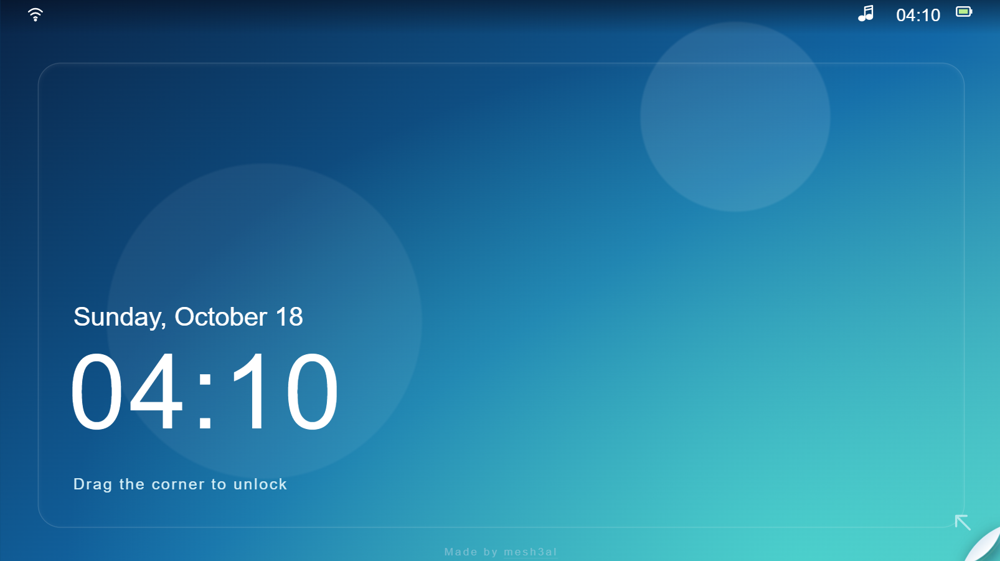
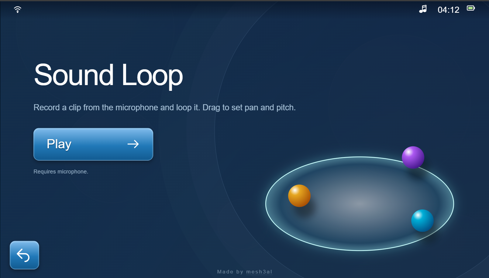
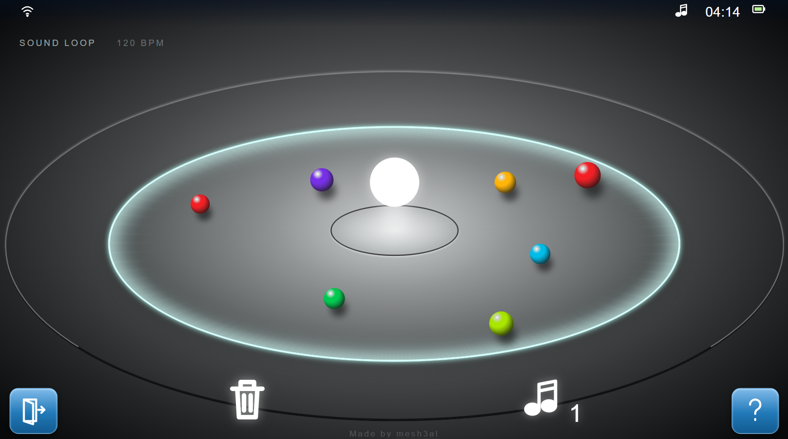

# Sound Loop

A tribute to Welcome Park on the PS Vita. Hold to record your voice through the mic, it turns into a floating orb that loops forever, and you drag the orbs around to change pan and pitch.

**Demo: https://soundloopvita.vercel.app/**

Use headphones and allow the microphone. Best on desktop Chrome for now.

| Lock screen | Welcome | Sound Loop |
| --- | --- | --- |
|  |  |  |

## Why i made this

In 2015 I got a PS Vita as a gift when I was a kid. It had no games on it. But it had Welcome Park, and me and my little brother played the sound loop one all day.
We'd yell into the mic, stack them up and laugh at how it sounded.
This is my way of paying tribute to that :)

It's inspired by Welcome Park on Vita, not a copy. The icons, sounds and background music are all original, and none of Sony's assets are used. Not affiliated with Sony.

## How it works

It's plain HTML, CSS and JavaScript.

1. Hold the screen and the mic records.
2. When you let go, the recording becomes an orb that loops.
3. Loops wait for the next beat (120 BPM) so they stay in time.
4. Drag left/right for pan, up/down for pitch. Pitch snaps to a scale so stacked loops don't clash.
5. Orbs fade out after about 75 seconds unless you touch them, and there's a limit of 16 at once.

The audio goes through a chain: recording, panner (left/right), volume, then a compressor so lots of orbs at once don't get too loud.

## The code

I put a simplified version in [`examples/`](examples/) that shows the main chain: mic, buffer, looping source, panner, speakers. It's much smaller than the real app (no beat sync, no silence trimming, no scales). To try it, serve the folder and open `examples/index.html`:

    python -m http.server 8000

Then go to http://localhost:8000/examples/ (that command is the only Python involved).

## me

I'm learning HTML, CSS and JavaScript. To understand the core of this
project, I wrote a simplified version myself (see `examples/`): record from
the mic, loop it, change pan and pitch.

## What I'm learning from it

- **Web Audio API.** How sound moves through a chain of nodes.
- **Using the mic in the browser.** Permissions, and why it only works on localhost or HTTPS.
- **Keeping loops in time.** Starting loops on a shared beat so they don't sound like a mess.
- **Pointer events.** Dragging with a mouse or a finger.
- **The page peel.** Using SVG clipping to fake a curled page.

## Still in beta

- The mic is failing on my phone and the screen doesn't fit properly on some phones. I'm working on both.
- Not tested on Safari yet.
- I couldn't get the orb spinning right. Making something move smoothly in a
  circle turned out to be harder than it looks (it needs animation timing and
  some maths), so I left it out for now.
- I want to build more mini-apps from Welcome Park later.

## Credit

Made by mesh3al.
If you try it, break it or have ideas, message me. I'm always around.

Email: syxxpath@gmail.com
Instagram: @skrptal
